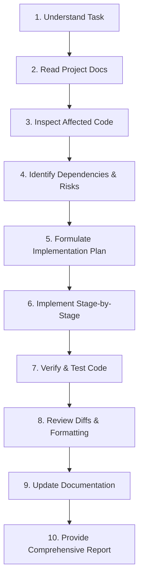

# AI Coding Agent Guidelines — Aayush Panchal Portfolio

> **Role & Authority:** This document serves as the primary operational instruction manual for all AI coding agents (such as Antigravity, Claude Code, OpenAI Codex, Cursor, etc.) operating in this repository.

---

## 1. Core Operating Principles

1. **Inspect Before Modifying:** Always inspect the workspace, existing code, and relevant documentation before making any modifications.
2. **Follow the Approved Tech Stack:**
   - **Frontend:** Semantic HTML5, CSS3 Custom Properties, Modern Vanilla ES6+ JavaScript.
   - **Animation:** GSAP 3.x + ScrollTrigger (via CDN or local vendor script).
   - **Icons:** Lucide Icons (inline SVG or minimal script).
   - **Strict Boundary:** **DO NOT** introduce React, Vue, Angular, Svelte, Tailwind CSS, Bootstrap, jQuery, or any bundler/transpiler (Vite, Webpack) unless explicitly authorized in the project documentation.
3. **Strict Adherence to Design Tokens:** Never hardcode arbitrary hex colors, font families, or spacing units. All styles must use CSS custom properties defined in [DESIGN_SYSTEM.md](file:///c:/Users/aayup/Desktop/Portfolio%20website/docs/02-design/DESIGN_SYSTEM.md).
4. **Preserve Working Functionality:** Never overwrite or refactor working modules blindly. Understand existing dependencies before applying changes.
5. **No Speculative Requirements:** Implement only features approved in [PROJECT_REQUIREMENTS.md](file:///c:/Users/aayup/Desktop/Portfolio%20website/docs/01-project-planning/PROJECT_REQUIREMENTS.md). Do not fabricate resume details, degrees, awards, or project metrics.

---

## 2. Multi-Stage Execution Workflow

Every coding task undertaken by an AI agent must strictly follow these 10 steps:

1. **Understand Task:** Verify requirements and check if user feedback or clarification is needed.
2. **Read Project Docs:** Check the corresponding specifications in `docs/` (e.g. `UI_UX_SPECIFICATION.md` for UI components, `ANIMATION_GUIDELINES.md` for GSAP motion).
3. **Inspect Affected Code:** Read targeted files completely; never guess function signatures or DOM selectors.
4. **Identify Dependencies & Risks:** Assess impact on performance, responsive viewports, and accessibility.
5. **Formulate Implementation Plan:** Define exact files to modify/create and validation steps.
6. **Implement Stage-by-Stage:** Apply changes cleanly in logical, verifiable increments.
7. **Verify & Test Code:** Run verification scripts, inspect console output, and ensure zero regressions.
8. **Review Diffs:** Verify no unintended formatting churn or unwanted file creation occurred.
9. **Update Documentation:** Keep `CHANGELOG.md` and `docs/04-development/TASK_TRACKER.md` synchronized with progress.
10. **Provide Comprehensive Report:** Summarize what was built, files altered, tests run, and remaining steps.

---

## 3. Architecture & File Ownership Boundaries

AI agents must place files in their designated directories as specified in [FOLDER_STRUCTURE.md](file:///c:/Users/aayup/Desktop/Portfolio%20website/docs/03-technical/FOLDER_STRUCTURE.md):

- `index.html` — The single-page semantic DOM structure.
- `css/` — Modular CSS files:
  - `variables.css` — Design tokens (colors, fonts, spacing, shadows).
  - `reset.css` — Modern reset and box-sizing normalization.
  - `typography.css` — Fluid typography and font pairings.
  - `layout.css` — Grid systems, flex containers, and responsive shells.
  - `components.css` — Reusable buttons, cards, tags, badges, and modals.
  - `themes.css` — Dark (`data-theme="dark"`) and Light (`data-theme="light"`) theme styles.
  - `animations.css` — Pure CSS keyframes and transitions.
  - `responsive.css` — Responsive breakpoint overrides.
- `js/` — Modular ES6 JavaScript:
  - `main.js` — Application orchestrator and bootstrap.
  - `navigation.js` — Smooth scrolling, active scroll spy, and mobile drawer.
  - `theme.js` — Theme toggle engine, system preference listener, and localStorage persistence.
  - `hero-visual.js` — Interactive SVG/Canvas system node graph with physics and pulses.
  - `command-palette.js` — `Cmd+K` / `Ctrl+K` spotlight search and developer action HUD.
  - `projects.js` — Project carousel, filtering, and deep-dive case study drawer manager.
  - `journey.js` — Timeline milestone renderer and filter tabs.
  - `audio.js` — Web Audio API procedural sound synthesizer (opt-in).
  - `inspector.js` — Real-time performance HUD (FPS, DOM count, coordinates).
- `assets/` — Media assets:
  - `images/`, `projects/`, `profile/`, `icons/`, `fonts/`.

---

## 4. Coding & Verification Standards

- **Semantic Markup:** Always use proper elements (`<header>`, `<nav>`, `<main>`, `<section>`, `<article>`, `<footer>`). Avoid unnecessary `
` soups.
- **Accessibility:**
  - Every interactive element must be keyboard accessible (`Tab`, `Enter`, `Space`, `Escape`).
  - Active modals/drawers must trap focus and release it on close.
  - Provide `aria-label`, `aria-expanded`, and descriptive `alt` attributes.
  - Support `prefers-reduced-motion` at all times.
- **Performance:**
  - Avoid layout thrashing: batch DOM reads before writes.
  - Animations must strictly manipulate `transform` and `opacity`.
  - Use passive event listeners for scroll and mouse events (`{ passive: true }`).
- **Zero Secrets Rule:** Never commit API keys, personal credentials, or private tokens. All secrets or private endpoints must be configured via environment variables.

---

## 5. Completion Reporting Protocol

Upon finishing any assigned development phase, the AI agent must report:
1. **Summary of Work:** Concise explanation of what was achieved.
2. **Files Created / Modified:** Exact relative paths.
3. **Features Implemented:** Mapped directly to requirements (`FR-xxx` / `NFR-xxx`).
4. **Verification & Tests Run:** List of commands executed and observations made.
5. **Task Tracker Status:** Updated tasks in `TASK_TRACKER.md`.
6. **Next Recommended Actions:** Clear pointers for the next phase.

For deep technical details, refer to [AI_INSTRUCTIONS.md](file:///c:/Users/aayup/Desktop/Portfolio%20website/docs/04-development/AI_INSTRUCTIONS.md).

