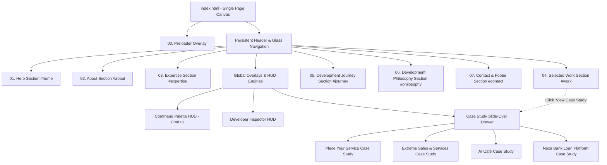

# Sitemap & Navigation Architecture: Aayush Panchal Portfolio

> **Architecture:** Single-Page Application (SPA) with Deep Anchor Routing & Accessible Modal/Drawer States  
> **Version:** 1.0.0  

---

## 1. Single-Page Section Hierarchy

The portfolio employs a high-performance single-page architecture where all primary content resides on a single unified canvas, augmented by accessible slide-over drawers for in-depth project case studies.

---

## 2. Detailed Navigation Routes & Anchor Map

| Route / Anchor | Type | Primary Content & Purpose |
|---|---|---|
| `/` or `#home` | Hero Section | Brand statement, availability status, CTAs, Interactive System Node Engine |
| `#about` | Content Section | Personal introduction, education, engineering philosophy, Resume download |
| `#expertise` | Content Section | Categorized 4-pillar skills matrix (Frontend, Backend, Database, AI/Cloud) |
| `#work` | Interactive Gallery | Pinned horizontal cinematic showcase for 4 core projects |
| `#journey` | Timeline Section | Chronological interactive timeline with category filter pills |
| `#philosophy` | Interactive Diagram | 4-stage engineering process (Discover → Design → Develop → Deliver) |
| `#contact` | Action Section | Professional email, LinkedIn, GitHub, Resume download, and contact form |

---

## 3. Dynamic Drawer & Overlay Sub-Routes

While operating on a single URL, stateful URL hashes or query parameters can trigger modal drawer views for direct linking and shareability:

| Overlay State | Trigger Mechanism | Content Presented |
|---|---|---|
| `?case-study=place-your-service` | Card CTA / Command Palette | Air conditioning SaaS platform architecture, trade-offs, and code viewer |
| `?case-study=extreme-sales` | Card CTA / Command Palette | Commercial redesign, multi-portal architecture, and animation engine |
| `?case-study=ai-cafe` | Card CTA / Command Palette | AI Barista e-commerce concept, dynamic beverage customizer |
| `?case-study=nexa-bank` | Card CTA / Command Palette | Express + PostgreSQL backend, JWT auth, init.sql migrations, and loan calculator |
| `cmd-k-active` | `Cmd+K`, `Ctrl+K`, or HUD Button | Spotlight fuzzy search, section jump, theme toggle, developer tools |
| `inspector-active` | Command Palette Command | Real-time FPS, DOM count, layout grid guidelines overlay |

---

## 4. External & Document Routes

| Asset / Destination | Target | Description |
|---|---|---|
| `/assets/docs/Aayush_Panchal_Resume.pdf` | Direct File Download | Verified, up-to-date professional software engineering resume |
| `mailto:aayushpanchal.dev@gmail.com` | Email Client | Direct professional correspondence |
| `https://github.com/Aayush-Panchal` | External Link (`_blank`) | GitHub profile showcasing public repositories and commit activity |
| `https://www.linkedin.com/in/aayush-panchal-24313044b` | External Link (`_blank`) | Professional LinkedIn profile for career networking |

