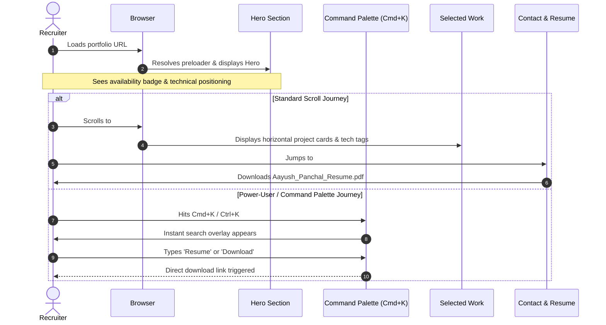
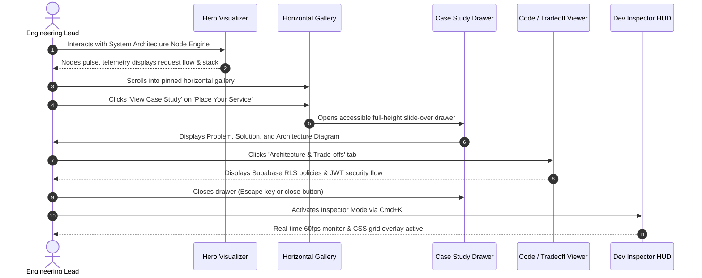
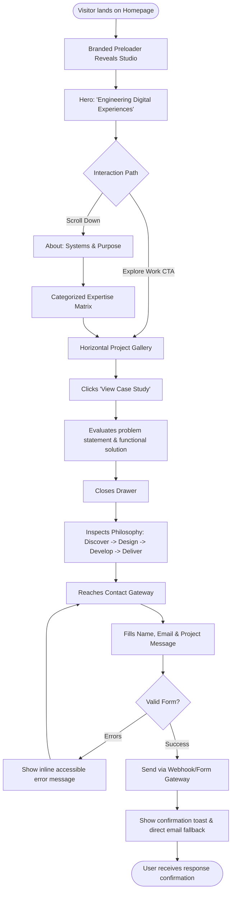

# User Flows: Aayush Panchal Portfolio

> **Document Status:** APPROVED  
> **Version:** 1.0.0  
> **Personas:** Engineering Recruiter, Technical Lead / Engineering Manager, Direct Client  

---

## 1. Primary Visitor Journeys

### User Flow 1: The Technical Recruiter (Fast Qualification Flow)
*Goal: Rapidly verify skills, assess project relevance, download the resume, and initiate contact in under 90 seconds.*

---

### User Flow 2: The Engineering Manager / Tech Lead (Deep Technical Audit)
*Goal: Verify code quality, examine systems thinking, explore architectural trade-offs, and inspect design execution.*

---

### User Flow 3: Direct Client or Freelance Partner (Project Evaluation Flow)
*Goal: Understand service capabilities, verify delivered products, and send an inquiry.*

---

## 2. Edge Cases, Empty States & Error Handling

| Scenario | System Behavior | Recovery Path |
|---|---|---|
| **Slow Network Connection** | Preloader displays subtle pulsing spinner with timeout limit (1.2s max). Critical styles render inline. | Page mounts gracefully even if heavy assets take longer. |
| **Offline / Network Disconnected** | Static site remains fully functional via browser cache; contact form shows clean offline warning badge. | Prompts user to use native `mailto:` link. |
| **JavaScript Disabled (No-JS Fallback)** | Core sections (Hero, About, Expertise, Work, Journey, Philosophy, Contact) render cleanly in standard vertical flow. | `<noscript>` tag informs visitor that animations and Command Palette require JS. |
| **Form Gateway Failure** | Form catches HTTP error or network failure, alerts visitor, and reveals direct clickable `mailto:` link with pre-filled subject. | Zero lost messages. |
| **Screen Reader Active** | Dynamic slide-over drawers trap focus with `role="dialog"` and `aria-modal="true"`. Escape key cleanly restores focus to trigger button. | Fully compliant with WCAG 2.1 AA. |

