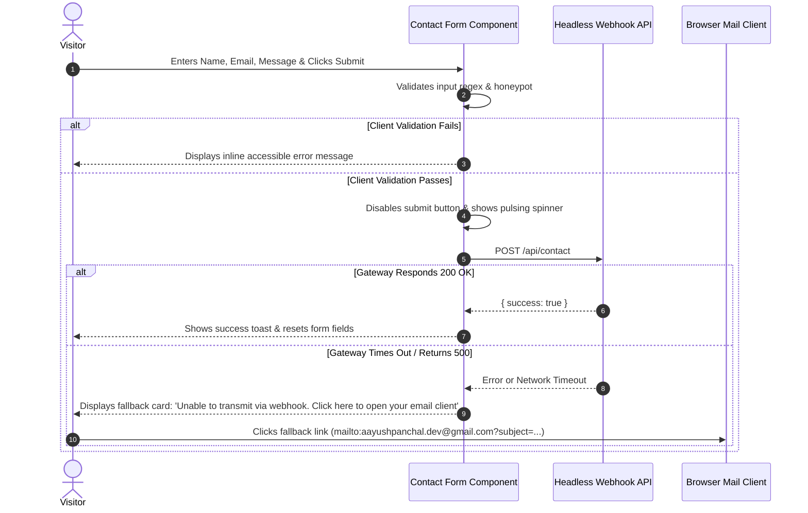

# API Specification & Contact Gateway Contract

> **Protocol:** HTTPS RESTful Webhook & Static Asset API  
> **Brand:** Aayush Panchal  
> **Version:** 1.0.0  

---

## 1. Contact Gateway Webhook Endpoint

Since Version 1.0 is a static web application hosted on Vercel, the contact form dispatches asynchronous submissions to a secure headless form gateway (e.g., Formspree, Web3Forms, or a custom Vercel Serverless Function).

### Endpoint Contract: `POST /api/contact` (or `https://api.web3forms.com/submit`)

#### Request Headers
```http
POST /api/contact HTTP/1.1
Host: api.web3forms.com
Content-Type: application/json
Accept: application/json
```

#### Request Payload Schema
```json
{
  "access_key": "YOUR_PUBLIC_ACCESS_KEY",
  "name": "Jane Doe",
  "email": "jane.doe@example.com",
  "project_type": "Full-Stack SaaS / Collaboration",
  "message": "Hi Aayush, we loved your Place Your Service case study and want to discuss an engineering role.",
  "botcheck": ""
}
```

#### Field Specifications & Validation Rules
| Field | Type | Required | Validation Constraints | Description |
|---|---|---|---|---|
| `access_key` | String | Yes | Valid public key | Gateway routing token |
| `name` | String | Yes | Min 2, Max 80 chars; alphabet & spaces only | Sender's full name |
| `email` | String | Yes | RFC 5322 compliant regex | Reply-to email address |
| `project_type` | String | No | Enum: `Full-Stack`, `Frontend`, `Backend`, `Collaboration`, `Other` | Inquiry classification |
| `message` | String | Yes | Min 15, Max 2000 chars | Body of inquiry |
| `botcheck` | String | No | Must be empty (`""`) | Honeypot field for bot mitigation |

---

## 2. Response Specifications

### Success Response (`200 OK`)
```json
{
  "success": true,
  "message": "Inquiry transmitted successfully. Aayush will respond within 24 hours."
}
```

### Validation Error Response (`422 Unprocessable Entity`)
```json
{
  "success": false,
  "errors": {
    "email": "Please provide a valid corporate or personal email address."
  }
}
```

### Rate Limited Response (`429 Too Many Requests`)
```json
{
  "success": false,
  "message": "Submission threshold exceeded. Please email aayushpanchal.dev@gmail.com directly."
}
```

---

## 3. Client-Side Error Handling & Fallback Flow



---

## 4. Static Asset Caching & Delivery Headers (Vercel CDN)

Production static assets served via Vercel Edge CDN utilize strict caching policies:

| Asset Type | Path Pattern | Cache-Control Header |
|---|---|---|
| **HTML Documents** | `/*.html`, `/` | `public, max-age=0, must-revalidate` |
| **Fingerprinted Images/Docs** | `/assets/**/*` | `public, max-age=31536000, immutable` |
| **CSS & JS Modules** | `/css/*`, `/js/*` | `public, max-age=86400, stale-while-revalidate=604800` |
| **Static JSON Schemas** | `/assets/data/*.json` | `public, max-age=3600, stale-while-revalidate=86400` |

