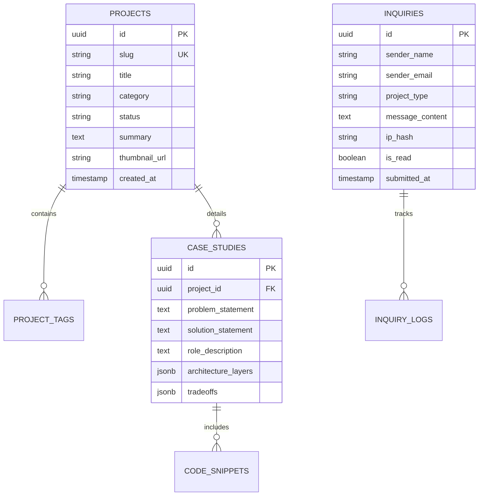

# Data Models & Schemas

> **Data Storage:** Client-side Static JSON (with future PostgreSQL / Supabase schema mappings)  
> **Brand:** Aayush Panchal  
> **Version:** 1.0.0  

---

## 1. Project & Case Study Schema (`assets/data/projects.json`)

Each project card and deep-dive case study drawer is governed by this validated JSON schema:

```json
{
  "$schema": "http://json-schema.org/draft-07/schema#",
  "title": "ProjectCaseStudy",
  "type": "object",
  "required": ["id", "title", "category", "status", "summary", "technologies", "caseStudy"],
  "properties": {
    "id": { "type": "string" },
    "title": { "type": "string" },
    "category": { "type": "string" },
    "status": { "type": "string", "enum": ["COMPLETED", "IN_DEVELOPMENT", "CONCEPT"] },
    "summary": { "type": "string" },
    "thumbnail": { "type": "string" },
    "technologies": {
      "type": "array",
      "items": { "type": "string" }
    },
    "links": {
      "type": "object",
      "properties": {
        "live": { "type": "string" },
        "github": { "type": "string" }
      }
    },
    "caseStudy": {
      "type": "object",
      "required": ["overview", "problem", "solution", "architecture", "tradeoffs", "codeSnippets", "outcomes"],
      "properties": {
        "overview": { "type": "string" },
        "problem": { "type": "string" },
        "solution": { "type": "string" },
        "role": { "type": "string" },
        "architecture": {
          "type": "object",
          "properties": {
            "description": { "type": "string" },
            "diagramType": { "type": "string" },
            "layers": {
              "type": "array",
              "items": { "type": "string" }
            }
          }
        },
        "tradeoffs": {
          "type": "array",
          "items": {
            "type": "object",
            "properties": {
              "decision": { "type": "string" },
              "chosen": { "type": "string" },
              "rejected": { "type": "string" },
              "reason": { "type": "string" }
            }
          }
        },
        "codeSnippets": {
          "type": "array",
          "items": {
            "type": "object",
            "properties": {
              "filename": { "type": "string" },
              "language": { "type": "string" },
              "description": { "type": "string" },
              "code": { "type": "string" }
            }
          }
        },
        "outcomes": {
          "type": "array",
          "items": { "type": "string" }
        }
      }
    }
  }
}
```

---

## 2. Development Journey Timeline Schema (`assets/data/journey.json`)

```json
{
  "$schema": "http://json-schema.org/draft-07/schema#",
  "title": "JourneyMilestone",
  "type": "object",
  "required": ["id", "period", "title", "organization", "category", "description"],
  "properties": {
    "id": { "type": "string" },
    "period": { "type": "string" },
    "year": { "type": "number" },
    "title": { "type": "string" },
    "organization": { "type": "string" },
    "category": { "type": "string", "enum": ["EDUCATION", "PROJECT", "MILESTONE"] },
    "description": { "type": "string" },
    "highlights": {
      "type": "array",
      "items": { "type": "string" }
    },
    "tags": {
      "type": "array",
      "items": { "type": "string" }
    }
  }
}
```

---

## 3. Future Backend Database Entity-Relationship Mapping (Version 2.0 Roadmap)

When migrating from client-side JSON to a live Supabase / PostgreSQL backend, the following relational schema will store contact inquiries and dynamic project telemetry:



