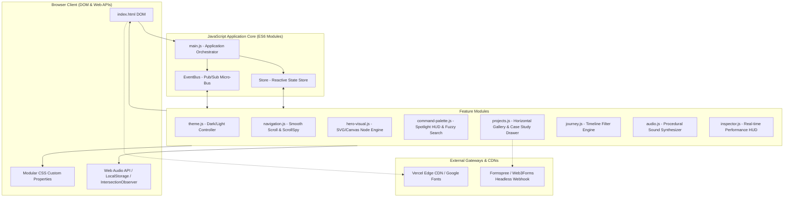
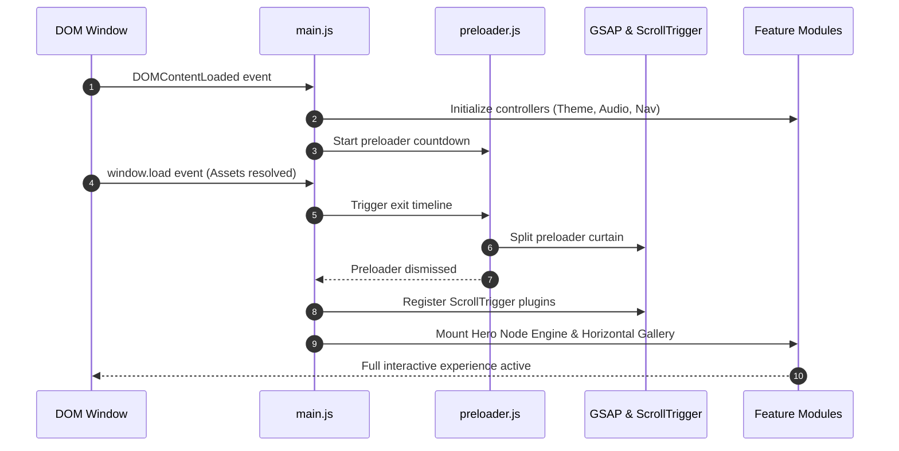

# System Architecture & Technical Design

> **Architecture:** Modular Event-Driven Client-Side Single Page Application  
> **Brand:** Aayush Panchal  
> **Version:** 1.0.0  

---

## 1. High-Level System Architecture Diagram



---

## 2. Event-Driven Communication Architecture (Micro-EventBus)

To maintain absolute modularity and prevent spaghetti cross-module coupling, all modules communicate via a lightweight native CustomEvent Pub/Sub bus:

```javascript
// core/event-bus.js
export const eventBus = {
  on(event, callback) {
    window.addEventListener(`studio:${event}`, (e) => callback(e.detail));
  },
  emit(event, detail = {}) {
    window.dispatchEvent(new CustomEvent(`studio:${event}`, { detail }));
  }
};
```

### Global System Events:
- `studio:theme-changed` (`{ theme: 'dark' | 'light' }`): Triggered by theme switcher or Command Palette; re-renders canvas node colors and updates CSS attributes.
- `studio:sound-trigger` (`{ type: 'click' | 'hover' | 'theme' | 'open' }`): Prompts the Web Audio synthesizer to generate sound if unmuted.
- `studio:open-case-study` (`{ projectId: string }`): Tells `projects.js` to populate and slide open the case study drawer.
- `studio:close-case-study`: Closes drawer and restores focus.
- `studio:toggle-command-palette`: Opens or closes the `Cmd+K` HUD.
- `studio:toggle-inspector`: Toggles the real-time performance monitor.

---

## 3. Reactive State Management

A lightweight state object handles global reactive parameters without third-party libraries:

```javascript
// core/store.js
export const store = {
  state: {
    theme: localStorage.getItem('studio_theme') || (window.matchMedia('(prefers-color-scheme: dark)').matches ? 'dark' : 'light'),
    audioEnabled: localStorage.getItem('studio_audio') === 'true',
    activeSection: 'home',
    activeCaseStudy: null,
    isCommandPaletteOpen: false,
    isInspectorActive: false
  },
  
  get(key) {
    return this.state[key];
  },
  
  set(key, value) {
    this.state[key] = value;
    if (key === 'theme') localStorage.setItem('studio_theme', value);
    if (key === 'audioEnabled') localStorage.setItem('studio_audio', value);
    eventBus.emit(`state:${key}`, value);
  }
};
```

---

## 4. Module Lifecycles & Execution Flow



---

## 5. Security & Privacy Architecture

- **Content Security Policy (CSP):** Strict script-src and style-src whitelist restricting execution to trusted CDNs (`cdnjs.cloudflare.com`, `fonts.googleapis.com`).
- **Zero Third-Party Trackers:** No intrusive tracking scripts, cookies, or fingerprinters are loaded.
- **Client-Side Form Sanitization:** Contact submissions validate regex patterns, strip script injections, and employ rate limiting on the client before dispatching to the form gateway.
- **Subresource Integrity (SRI):** External CDN dependencies include cryptographic hash checks to eliminate supply-chain tampering.

