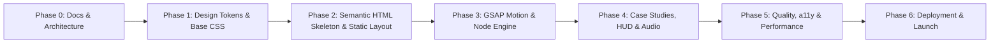

# Engineering Implementation Roadmap

> **Project:** Aayush Panchal Personal Developer Portfolio  
> **Development Approach:** Phased, Independently Verifiable Milestones  
> **Target Delivery:** Production-Ready Web Application on GitHub & Vercel  
> **Version:** 1.0.0  

---

## 1. Roadmap Overview & Timeline

The portfolio development process is organized into 6 consecutive, independently testable phases:

---

## 2. Phase-by-Phase Specifications

### Phase 0: Documentation & Architecture Blueprint
- **Objective:** Establish the comprehensive documentation foundation using the Universal Website Documentation Framework.
- **Scope:** 28 documentation specifications across planning, design, technical, quality, and deployment domains.
- **Dependencies:** Approved project proposal.
- **Deliverables:** Root files (`README.md`, `AGENTS.md`, `CHANGELOG.md`) and all 25 modular `docs/` files.
- **Acceptance Criteria:** All internal links resolve; zero application code generated; full alignment with Aayush's technical identity.

---

### Phase 1: Design Tokens, Typography & Base CSS
- **Objective:** Implement the approved 6-color system, typography scales, layout reset, and dark/light theme engine.
- **Scope:**
  - Create `css/variables.css` with exact hex primitives, font stacks, and fluid spacing tokens.
  - Create `css/reset.css` for modern box-sizing, margin resets, and focus outlines.
  - Create `css/typography.css` for Space Grotesk, Inter, and JetBrains Mono hierarchies.
  - Create `css/themes.css` with data-attribute selectors (`[data-theme="dark"]`, `[data-theme="light"]`).
  - Create `js/modules/theme.js` for theme switching, OS sync, and `localStorage` persistence.
- **Acceptance Criteria:** Theme switches seamlessly between Midnight Navy and Warm White without flash of unstyled content (FOUC); font weights render crisply.

---

### Phase 2: Semantic HTML Skeleton & Static Layouts
- **Objective:** Build the complete semantic DOM structure for all 8 website sections.
- **Scope:**
  - Create `index.html` with full semantic elements (`<header>`, `<nav>`, `<main>`, `<section>`, `<article>`, `<footer>`).
  - Scaffold Preloader, Hero, About, Expertise, Selected Work, Journey, Philosophy, and Contact sections.
  - Implement `css/layout.css` (12-column responsive grid, flex wrappers) and `css/components.css` (buttons, cards, badges).
  - Populate structured static JSON files: `assets/data/projects.json`, `assets/data/journey.json`, `assets/data/skills.json`.
- **Acceptance Criteria:** The entire page renders cleanly and legibly with semantic styles even if JavaScript is disabled.

---

### Phase 3: Motion Engineering, Hero Node Engine & Horizontal Gallery
- **Objective:** Implement GSAP 3.x timelines, the interactive Hero SVG node visualizer, and the pinned horizontal project gallery.
- **Scope:**
  - Integrate GSAP and ScrollTrigger via CDN.
  - Create `js/modules/preloader.js` for wordmark reveal and vertical curtain exit.
  - Create `js/modules/hero-visual.js` rendering the dynamic SVG/Canvas node network with spring physics and packet pulses.
  - Create `js/modules/projects.js` orchestrating the horizontal scroll track for desktop and native swipe for touch screens.
  - Create `js/modules/navigation.js` for sticky glassmorphic header and active scroll spy.
- **Acceptance Criteria:** Scroll animations run at a sustained 60fps; hero nodes respond to cursor movement; horizontal gallery snaps smoothly.

---

### Phase 4: Command Palette HUD, Case Study Drawer & Audio Engine
- **Objective:** Build the high-impact studio features that set the portfolio apart.
- **Scope:**
  - Create `js/modules/command-palette.js` for `Cmd+K` / `Ctrl+K` spotlight search and section jumps.
  - Create `js/modules/inspector.js` for real-time FPS, DOM count, and grid overlay HUD.
  - Create slide-over Case Study Drawer inside `js/modules/projects.js` with architecture diagrams and tabbed code viewers.
  - Create `js/modules/audio.js` using native HTML5 Web Audio API for procedural tactile clicks (opt-in).
  - Create `js/modules/contact.js` for form validation and webhook transmission.
- **Acceptance Criteria:** Focus traps properly inside the open drawer; `Escape` key dismisses drawer; sound plays only when unmuted; contact form validates inputs correctly.

---

### Phase 5: Quality Assurance, Accessibility & Performance Audits
- **Objective:** Optimize the codebase to meet strict production benchmarks.
- **Scope:**
  - Audit keyboard navigation across all interactive elements.
  - Verify WCAG 2.1 AA color contrast in both dark and light modes.
  - Implement `prefers-reduced-motion` overrides across all GSAP timelines.
  - Optimize image assets (convert to WebP, apply explicit `width`/`height` attributes).
  - Run Google Lighthouse automated audits.
- **Acceptance Criteria:** Performance >= 95, Accessibility >= 98, Best Practices = 100, SEO = 100 on Lighthouse.

---

### Phase 6: Production Deployment & Verification
- **Objective:** Deploy the portfolio to Vercel via GitHub and verify real-world edge delivery.
- **Scope:**
  - Initialize clean Git repository and verify commit history.
  - Push to GitHub remote.
  - Connect repository to Vercel with zero-configuration static output.
  - Verify HTTPS, custom domain (if configured), and HTTP security headers.
  - Conduct final live smoke tests on iOS and Android mobile devices.
- **Acceptance Criteria:** Live public URL accessible, sub-second global load times, verified resume download link.

