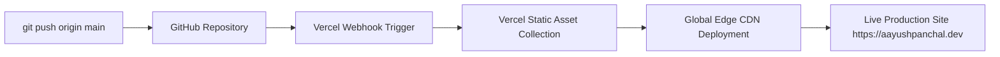

# Deployment Guide: GitHub & Vercel Pipeline

> **Host:** Vercel Edge Network  
> **Source Repository:** GitHub (`Aayush-Panchal/portfolio`)  
> **Architecture:** Zero-Config Static Web Application  
> **Version:** 1.0.0  

---

## 1. Local Development Setup

To preview and work on the portfolio locally without installing heavy runtimes or bundlers:

```bash
# 1. Clone repository
git clone https://github.com/Aayush-Panchal/portfolio.git
cd portfolio

# 2. Launch local static server (using any standard lightweight server)
# Python 3:
python -m http.server 3000

# OR Node.js (npx serve):
npx serve . -l 3000

# OR VS Code Live Server extension
```

Navigate to `http://localhost:3000` in your browser. Changes to HTML, CSS, or JS take effect immediately upon browser refresh.

---

## 2. GitHub Deployment & Version Control Workflow

1. **Main Branch Protection:** The `main` branch represents production-tested, deployable code.
2. **Feature Branching:** For substantive enhancements:
   ```bash
   git checkout -b feat/interactive-node-engine
   git commit -m "feat(hero): integrate interactive canvas node visualizer"
   git push origin feat/interactive-node-engine
   ```
3. **Commit Verification:** Ensure no temporary scratch files, `.DS_Store`, or private keys are staged prior to pushing.

---

## 3. Vercel Zero-Configuration Deployment

Vercel provides native static edge hosting with zero build step overhead:



### Steps to Connect:
1. Log into your Vercel dashboard (`vercel.com`).
2. Click **Add New...** -> **Project**.
3. Import your GitHub repository (`portfolio`).
4. Framework Preset: Select **Other** (Pure HTML/CSS/JS).
5. Build and Output Settings: Leave default (Root Directory: `./`, Build Command: empty, Output Directory: `./`).
6. Click **Deploy**. Vercel will instantly publish the site across its global edge network in ~10 seconds.

---

## 4. Production Security Headers (`vercel.json`)

To enforce strict security and browser protection, create a `vercel.json` configuration:

```json
{
  "cleanUrls": true,
  "trailingSlash": false,
  "headers": [
    {
      "source": "/(.*)",
      "headers": [
        {
          "key": "X-Content-Type-Options",
          "value": "nosniff"
        },
        {
          "key": "X-Frame-Options",
          "value": "DENY"
        },
        {
          "key": "X-XSS-Protection",
          "value": "1; mode=block"
        },
        {
          "key": "Referrer-Policy",
          "value": "strict-origin-when-cross-origin"
        },
        {
          "key": "Permissions-Policy",
          "value": "camera=(), microphone=(), geolocation=()"
        }
      ]
    },
    {
      "source": "/assets/(.*)",
      "headers": [
        {
          "key": "Cache-Control",
          "value": "public, max-age=31536000, immutable"
        }
      ]
    }
  ]
}
```

---

## 5. Rollback & Disaster Recovery Procedures

If an unexpected regression is discovered in production:
1. Open the **Deployments** tab in the Vercel Dashboard.
2. Identify the previous known stable deployment.
3. Click the three dots (`...`) and select **Instant Rollback**.
4. The edge CDN switches routing immediately (<2 seconds) without needing a new Git commit.

